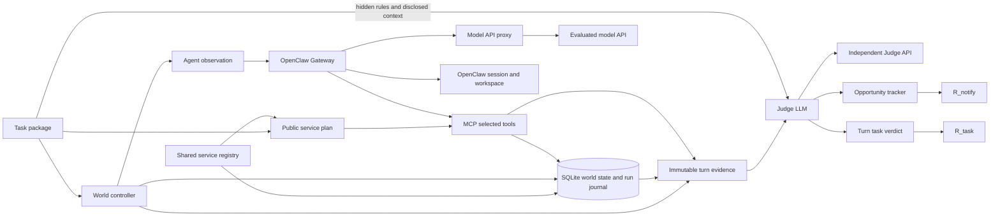

# Proactive Agent Benchmark Framework

Reusable infrastructure for long-horizon simulated tasks. `examples/travel_beijing_realistic` is the sole public task example; small internal fixtures live under `tests/fixtures/`. A production benchmark dataset is intentionally deferred.

## Architecture



The controller groups events by timestamp. Each timestamp is an environment tick, even if no agent runs. It applies all mutations in file order, captures `world_pre`, then invokes one Agent Turn if a user message, notification, or scheduled wakeup occurs. OpenClaw handles its own planning, model calls, session history, and tool loop. The controller gathers MCP calls from the service audit log and proactive notifications from a simulated inbox. `world_post`, response, and workspace/session reference complete the frozen turn evidence. Task and notification judging are separate calls. Subsequent ticks continue from each run's persistent SQLite state.

The Agent sees only scheduled messages, its OpenClaw session and workspace, and the task-selected MCP tools. It never receives future events, authoritative snapshots, `goal_context_t`, or judge files. The controller builds `goal_context_t` only from user-message disclosures through the current turn. The judge sees that context, hidden rules, authoritative snapshots, action evidence, prior evidence, and opportunity state. The OpenClaw container mounts only its state volume and a config generator; judge files, run evidence, and Judge credentials are absent. The world service receives a public service plan containing only service bindings and allowed tools. No real channel is configured. The private Docker network has no external route; only the narrow model proxy can reach the configured Agent model API.

## Package schema

`manifest.yaml`: `task_id`, `metadata`, timezone-aware `initial_timestamp`, `duration_seconds`, `services` bindings, initial `workspace_files`, `tool_permissions` mapping binding IDs to operations, `judge` settings (`completion_policy: expire|keep`), and relative paths `initial_world`, `events`, `context`, `notification_rules`, `judge_instructions`, and `evidence_sources`. A binding has `id`, registered `service`, optional service `config`, and optional `tool_prefix`. The legacy `adapters: [kv]` field remains supported. The two new Judge paths are optional for older tasks and must resolve inside that task's `judge/` directory.

`initial_world.yaml`: mapping of service binding ID to that task's initial JSON-compatible state. The same registered service can be bound by multiple tasks with different data and events. Each run has its own SQLite database. Services validate state and operation arguments before execution. The controller alone can inspect snapshots and history. `reset` and `replay` reproduce recorded operations from the initial state and check result/changes for divergence.

## Reusable services

[`services.py`](src/probench/services.py) defines `DomainAdapter`, `OperationSpec`, `ServiceBase`, and `ServiceRegistry`. Each service provides a Pydantic state schema, typed input models for operations, read/write classification, descriptions, and an `execute` implementation. Register a factory under a stable service name, then select it in task manifests. For a separate module, set `BENCH_SERVICE_MODULES=your_package.service_module` in all benchmark services; that module should register its factory in `DEFAULT_REGISTRY`. The built-in `records` adapter backs Email, Calendar and Transit in the travel example. `travel_services.py` adds policy-enforcing Flight and Hotel adapters plus read-only Expense records. `kv` and `counter` remain internal test services; their task fixtures are under `tests/fixtures/`. Live provider integrations are deferred.

`bench prepare <task_path> --output <plan_path>` writes a public plan from the task package. Docker Compose runs this as an isolated preparation service before starting the world service. [`world_mcp.py`](src/probench/world_mcp.py) registers only the permitted operations from that plan as typed MCP tools, plus the simulated `notify_user` tool. The world service has no task-package mount, and the OpenClaw container has neither the package nor the plan mounted. The controller checks the plan against the selected task before each run; the MCP service checks its digest and permissions for every Turn. A new Docker Compose project and run name are required when switching task packages.

`events.yaml`: time-sorted list with unique `id`, timezone-aware `at`, `kind` (`world_mutation`, `user_message`, `notification`, `scheduled_wakeup`, `time_advance`), optional `adapter`, `operation`, `arguments`, and `body`. Silent mutation is allowed. Multiple events may share a timestamp.

`context.yaml`: disclosures keyed to `user_message` event IDs. Each has `goals`, `preferences`, `constraints`, and optional `interaction`. The Judge context orders them by event timeline; future rows are never included in an earlier Turn.

`judge/notification_rules.yaml`: judge-only candidate rules with `id`, `description`, `trigger_event_ids`, `deadline_seconds`, `related_goal`, `content_requirements`, `closing_conditions`, `unnecessary_conditions`, `authorization_requirements`, and optional `dedupe_guidance` and `actionability_guidance`. Event IDs are clues, never proof that notification is required. The LLM Judge checks actual impact, active goals, independent remedies, authorization needs, urgency and prior opportunities. Rules are hidden from the Agent; legitimate user preferences arrive through user messages.

### Judge instructions and evidence sources

The shared [global Judge rubric](src/probench/global_judge_rubric.md) defines the four task scores, notification scores, priority, evidence reference syntax, and JSON output contract. Each task may add `judge/instructions.md` for domain interpretation: active goals and cancellations, relevant state relationships, meaningful progress, notification conditions, and safety or authorization dependencies. These instructions supplement the global rubric and cannot change scores. The Judge system message contains the global rubric; task instructions and evidence are supplied as data and are explicitly treated as untrusted. The Judge must use only `goal_context_t` disclosed through the current Turn.

`judge/evidence_sources.yaml` selects bounded evidence content, not arbitrary filesystem paths. For example:

```yaml
sources: [goal_context_t, world_pre, world_post, triggering_events, action_trace, tool_results, agent_response, previous_turns, world_history, previous_notifications, opportunities]
previous_turn_limit: 3
previous_notification_limit: 50
world_history_limit: 30
```

Current goal context, pre/post state, event references, actions, tool results, response, and opportunity state are required. Optional sources are `previous_turns`, `backend_state`, `world_history`, and `previous_notifications`. The evidence loader reads prior immutable Turn JSON from the selected run's `evidence/` directory, checks path confinement, task ID, Turn order, and timestamp, and sends selected content rather than filenames. World history is bounded and filtered through the current simulated time. Prior Turn records omit workspace data and other unnecessary fields. The Judge API response is schema-validated and each cited evidence reference must identify available supplied evidence. An event ID alone cannot justify a new notification opportunity; the proposal must also cite condition evidence. Missing files, future references, malformed responses, and invalid citations fail explicitly.

## Evidence and scoring

Each `evidence/turn_NNNN.json` contains event IDs, timestamp, disclosed context, observation, Turn-boundary pre/post state, ordered action trace and tool results, response, memory versions/delta, and related opportunities. OpenClaw session memory uses logical before/after version references tied to its persistent session. Evidence files are written once; `evidence_hashes.json` verifies their bytes. `turns/` adds separate judge verdicts. These JSON files are compatibility exports; `world.db` is the authoritative runtime store. `ticks.json`, compact `world_history.json`, `opportunity_history.json`, `report.json`, and `report.txt` support inspection and replay checks. Generated runs are ignored by Git.

### SQLite run journal and Tick checkpoints

Each run has one `world.db`. The `state` table holds current service state. `history` stores operation results, domain changes, and JSON Patches rather than full before/after worlds for each action; `state_at(seq)` reconstructs a historical world from task initial state and patches. `ticks` stores ordered event IDs, timestamp, optional Turn ID, and the completed Tick record. `events` stores each event in execution order. `mcp_actions` stores one row per tool call with `action_id`, and `notifications` stores actual simulated inbox deliveries with `notification_id` and the originating `action_id`. `turns` retains boundary snapshots and response/memory evidence; action and notification lists are read from their own tables when resuming.

`judgments` stores each Tick's task/notification verdict, evidence references, raw LLM output, and an `applied_result` pointing to the validated opportunity-history rows and quiet-score decision. Its `input_hash` points to `judge_inputs`, which deduplicates identical Judge inputs. `opportunities` stores the source Event and Tick, first actionable Turn, deadline, settlement Turn and final score. `opportunity_attempts` stores each Judge-assessed notice attempt; `opportunity_notifications` is a many-to-many link; `opportunity_history` appends all status and attribution changes. A completed Tick is committed to SQLite after its Judge and opportunity updates. Old run databases are migrated on open; historic attribution is inferred from their earliest recorded Agent Turn because older runs did not record actionability.

`notify_user(text)` writes to the simulated inbox and returns a `notification_id`; the Agent never supplies a hidden Opportunity ID. On every Tick, including silent ones, the Notification Judge may propose zero or more opportunities. Each proposal supplies a stable episode key to merge repeated reports of one underlying problem. On an Agent Turn, the Judge identifies the first reasonable action opportunity and assesses each real notice as partial, complete or harmful for each linked obligation. Python validates the notification IDs, successful MCP actions and actual send times. One notice may cover several opportunities, but each is judged separately; several notices over different Turns may complete one opportunity. A partial attempt stays pending until a complete notice or the deadline. Serious harm settles at -1. Expiry without an actionable Turn is excluded from `R_required`.

For an Opportunity created and assessed in the same Judge response, the Judge refers to its own `rule_id` plus `dedupe_key`; Python resolves that pair to the canonical ID. Existing obligations are referenced by their supplied `opportunity_id`.

[`judge_evidence.py`](src/probench/judge_evidence.py) builds the Judge API input as `tick`, ordered `events`, `goal_context`, boundary `world_state`, `world_changes`, `actions`, `current_notifications`, `active_opportunities`, and bounded `relevant_history`. It excludes future Events, disclosures, attempts and settlement state even when inspecting an earlier Turn after a run is complete. The global Judge rubric now defines episode deduplication, actionability and partial-notice handling; both score formulas are unchanged.

Completed-Tick resume remains supported with `--resume` and the same run directory. OpenClaw also requires its original Gateway volume, provider and model. Recovery from an interruption inside a Tick is outside scope.

The Judge gives each **Turn** exactly one task score: harmful/violation `-1` takes priority, then goal progress `+1`, useful new actionable information `+0.5`, otherwise `0`. `R_task = max(0, sum(turn scores) / turn count)`. Individual actions are evidence, never scored separately. The production Judge uses an OpenAI-compatible chat completion endpoint and validates JSON against Pydantic schemas and available evidence references; malformed output fails the run. `MockJudge` is a deterministic test double and cannot validate the quality of LLM judgments.

Required notifications are scored once per opportunity: complete before deadline `+1`, partial only at expiry `+0.5`, missing `0`, serious error `-1`. Resolution or cancellation receives no required score. `report.json.per_turn_notification_attribution` assigns each final result to its first actionable Turn and records the actual settlement Turn; the immutable original evidence is not rewritten. `R_required` averages scored opportunities, even when one Turn owns several. Pending Turns without unrelated notices are excluded from quiet scoring. An unrelated or duplicate notice contributes one `-1` not-required sample for that Turn even while another obligation is pending; several false notices in one Turn still count as one sample. A harmful notice already scored as Required is not penalized again as false. `R_not_required` averages eligible Turn samples, and `R_notify = max(0, 0.5*R_required + 0.5*R_not_required)`. If either category has no sample, `R_notify` is `null` (N/A). `R_task` and `R_notify` remain the only primary metrics.

## Run: `travel_beijing_realistic`

Install and validate the sole public example:

```bash
python -m pip install -e '.[test]'
bench validate examples/travel_beijing_realistic
pytest -q
```

An offline pipeline check needs no model credentials. `InspectAgent` chooses read-only queries from each current observation; `MockJudge` is a deterministic test double, so its scores do not measure model or Judge quality:

```bash
bench run examples/travel_beijing_realistic --agent probench.demo_agent:InspectAgent --judge mock --output runs/realistic-local
bench report runs/realistic-local
```

For a real evaluation, configure independent Agent and Judge API settings from `.env.example`, then run:

```bash
bench run examples/travel_beijing_realistic --agent openclaw --judge openai --output runs/realistic-api
bench report runs/realistic-api
```

The local `openclaw` hostname used by the default Gateway setting is supplied by Docker Compose; use the Docker workflow below for OpenClaw. Local non-Docker use requires a reachable Gateway and MCP world service configured separately.

### Files used by this run

| File or directory | Role | Agent access |
|---|---|---|
| `manifest.yaml` | Task ID, services, permissions, file paths | Only selected public tool plan |
| `initial_world.yaml` and `envs/*.yaml` | Initial records for six services | Through permitted MCP tools after they exist |
| `events.yaml` | Ordered mutations and wakeups | Only current visible event body and ID |
| `context.yaml` | Incremental user goals for Judge | User messages only |
| `judge/instructions.md`, `judge/notification_rules.yaml`, `judge/evidence_sources.yaml` | Judge guidance, hidden rules, evidence selection | No |
| `ground_truth.yaml` | Test and analysis expectations | No |
| `runs/<name>/world.db`, evidence and reports | Generated run state | MCP access only to permitted world operations |

`bench validate` loads the manifest through `schema.py`; `runtime.py` groups events into Ticks and invokes the Agent; `world.py` persists state; `world_mcp.py` exposes approved tools; `judge.py` and `scoring.py` produce separate `R_task` and `R_notify`. The old scripted 20-Turn travel task has been removed.

## Docker and OpenClaw

The production Agent adapter calls the [documented Gateway chat completions API](https://docs.openclaw.ai/gateway/openai-http-api) with one stable `user` per run. OpenClaw uses an [MCP server](https://docs.openclaw.ai/tools/mcp) for world reads, writes, and `notify_user`, and its [tool policy](https://docs.openclaw.ai/gateway/config-tools/tool-policy) excludes filesystem, shell, web, session, gateway, browser, and real messaging tools. The simulated inbox stores notification text and simulated timestamps. The Gateway model provider uses the [custom provider configuration](https://docs.openclaw.ai/gateway/config-tools/custom-providers) with `bench/${AGENT_MODEL}` as the actual model. `AGENT_API_BASE_URL` and `AGENT_API_KEY` are held only by the model proxy. The Judge API variables are held only by the benchmark orchestrator. Neither side implicitly inherits the other's provider settings.

Copy `.env.example` to `.env` and edit it. Set `BENCH_TASK_NAME` to a directory under `BENCH_TASKS_HOST_DIR` (default `./examples`). Use a unique `COMPOSE_PROJECT_NAME` and `BENCH_RUN_NAME` for each run. Set `OPENCLAW_GATEWAY_TOKEN` to a random value for nonlocal deployments. The official image is the default; `OPENCLAW_IMAGE` can pin a compatible version. The Docker volumes retain OpenClaw memory, while `runs/<BENCH_RUN_NAME>` retains world state and evidence. Do not reuse a run name without resetting its stack and run directory.

```bash
cp .env.example .env  # fill both API providers, model IDs, keys and Gateway token
export BENCH_RUN_NAME=realistic-api
export BENCH_TASK_NAME=travel_beijing_realistic
docker compose build benchmark
docker compose up -d --no-build openclaw world model-proxy
docker compose run --rm benchmark bench validate examples/travel_beijing_realistic
docker compose run --rm benchmark bench run examples/travel_beijing_realistic --agent openclaw --judge openai --output runs/realistic-api
docker compose run --rm benchmark bench report runs/realistic-api
```

Offline integration test (real OpenClaw with local mock Agent and Judge API servers):

```bash
OPENCLAW_IMAGE=ghcr.io/openclaw/openclaw:latest bash scripts/test_docker_integration.sh
```

Use `OPENCLAW_IMAGE=terrarium/openclaw:latest` only if that compatible local image is already installed. The script uses the realistic task with real OpenClaw and local mock model APIs, then checks tool calls, session isolation and both report metrics across two runs. It is an infrastructure test, not a semantic evaluation.

Real API smoke test after exporting all seven credentials/settings listed in `.env.example`:

```bash
bash scripts/test_real_api_smoke.sh
```

The script exits with status 77 if any required setting is missing; it never substitutes mock credentials. To reset containers, OpenClaw state, and the selected generated run:

```bash
BENCH_RUN_NAME=openclaw-demo bash scripts/reset_docker.sh
```

Known limitations: the offline Docker test uses a deterministic mock model API for reproducibility. The mock Judge tests plumbing, not judgment quality. The Gateway HTTP interface provides stable session continuation, while OpenClaw trajectory bundle export is not yet used as an additional evidence source. Docker networking restricts container routes, but host-level operators and Docker administrators retain access to mounted data. Real provider behavior and security policies should be smoke-tested with the chosen OpenClaw image before using untrusted tasks.

## Architectural reference

Studied [VibeLifeBench](https://github.com/evolvent-ai/VibeLifeBench) task entries, shared capability bindings, event handling, workspace bootstrap, tool traces, and stage state/rubrics. This framework shares service implementations across task packages while keeping each task's data and events independent. Its own additions are a task-independent LLM Judge contract, explicit cross-Turn notification opportunity settlement, dual independent metrics, isolated OpenClaw sessions, and an API proxy that confines Agent model egress. The synthetic fixtures are infrastructure evidence, not domain benchmarks.

