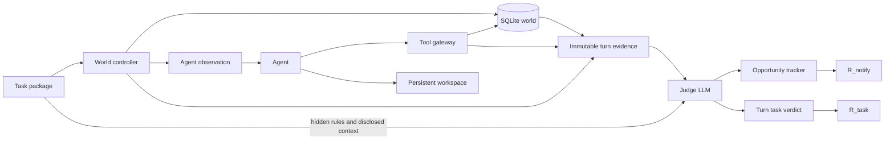

# Proactive Agent Benchmark Framework

Reusable infrastructure for long-horizon simulated tasks. The included fixture is synthetic and is only an end-to-end infrastructure check. Task domains and benchmark datasets are intentionally deferred.

## Architecture



The controller groups events by timestamp. Each timestamp is an environment tick, even if no agent runs. It applies all mutations in file order, captures `world_pre`, then invokes one Agent Turn if a user message, notification, or scheduled wakeup occurs. The agent may make any number of tool calls; each is recorded, including reads and failures. `world_post`, response, and workspace delta complete the frozen turn evidence. Task and notification judging are separate calls. Subsequent ticks continue from persistent SQLite state.

The Agent sees only scheduled messages, prior legitimate interaction history, its workspace, and permitted tools. It never receives future events, authoritative snapshots, `goal_context_t`, or judge files. The controller builds `goal_context_t` only from user-message disclosures through the current turn. The judge sees that context, hidden rules, authoritative snapshots, action evidence, prior evidence, and opportunity state. Embed an external agent in an isolated process/container whose mount contains only its workspace; do not mount the task package or run directory there.

## Package schema

`manifest.yaml`: `task_id`, `metadata`, timezone-aware `initial_timestamp`, `duration_seconds`, `adapters`, initial `workspace_files`, `tool_permissions` mapping adapter names to operations, `judge` settings (`completion_policy: expire|keep`), and relative paths `initial_world`, `events`, `context`, `notification_rules`. All paths are confined to the package root.

`initial_world.yaml`: mapping of adapter name to its initial JSON-compatible state. The included `kv` adapter supports `get` and `set`; register additional `DomainAdapter` implementations for future domains. Each run has its own SQLite database. Adapters declare read versus write operations with `is_mutating()` and implement them through `execute`; the controller alone can inspect snapshots and history. `reset` and `replay` reproduce recorded operations from the initial state and check result/changes for divergence.

`events.yaml`: time-sorted list with unique `id`, timezone-aware `at`, `kind` (`world_mutation`, `user_message`, `notification`, `scheduled_wakeup`, `time_advance`), optional `adapter`, `operation`, `arguments`, and `body`. Silent mutation is allowed. Multiple events may share a timestamp.

`context.yaml`: ordered disclosures keyed to `user_message` event IDs. Each has `goals`, `preferences`, `constraints`, and optional `interaction`. Future rows are never included in an earlier turn's judge context.

`judge/notification_rules.yaml`: judge-only rules with `id`, `description`, `trigger_event_ids`, `deadline_seconds`, `related_goal`, `content_requirements`, `closing_conditions`, `unnecessary_conditions`, and `authorization_requirements`. Task authors can express richer conditions in prose for an LLM Judge. Never place this file in the Agent workspace. Rules are hidden from the Agent, but legitimate user preferences must be conveyed in user messages.

## Evidence and scoring

Each `evidence/turn_NNNN.json` contains event IDs, timestamp, disclosed context, observation, pre/post state, ordered action trace and tool results, response, memory versions/delta, and related opportunities. Evidence files are written once; `evidence_hashes.json` verifies their bytes. `turns/` adds separate judge verdicts. `ticks.json`, `world_history.json`, `report.json`, and `report.txt` support inspection and replay checks. Generated runs are ignored by Git.

The Judge gives each **Turn** exactly one task score: harmful/violation `-1` takes priority, then goal progress `+1`, useful new actionable information `+0.5`, otherwise `0`. `R_task = max(0, sum(turn scores) / turn count)`. Individual actions are evidence, never scored separately. The production Judge uses an OpenAI-compatible chat completion endpoint and validates JSON against Pydantic schemas; malformed output fails the run. `MockJudge` is a deterministic test double and cannot validate the quality of LLM judgments.

Required notifications are scored once per opportunity: timely correct `+1`, partial `+0.5`, missed after deadline `0`, seriously wrong or unauthorized `-1`. Open obligations persist across Turns. Turns while an obligation is pending are excluded from ordinary silence scoring. Eligible quiet Turns score `+1` for silence or `-1` for unnecessary proactive notification. `R_required` and `R_not_required` are independent means, and `R_notify = max(0, 0.5*R_required + 0.5*R_not_required)`. If either category has no samples, its value and `R_notify` are `null` (N/A); weights are not changed. `R_task` and `R_notify` are the only primary metrics.

## Run

```bash
python -m pip install -e '.[test]'
bench validate examples/synthetic
bench run examples/synthetic --agent mock --judge mock --output runs/example
bench report runs/example
pytest -q
```

For a real Judge set `BENCH_JUDGE_BASE_URL`, `BENCH_JUDGE_API_KEY`, and `BENCH_JUDGE_MODEL`, then choose `--judge openai`. The API must support `/chat/completions` and JSON object response format. Pass `--agent module:Class` for an importable zero-argument Agent implementation, or call `run()` with custom Agent and adapter objects. The fixture remains runnable without credentials. External Agent process isolation, full domain adapters, real task packages, judge calibration, and operational deployment are future work.

## Architectural reference

Studied [VibeLifeBench](https://github.com/evolvent-ai/VibeLifeBench) task entries, event handling, workspace bootstrap, tool traces, and stage state/rubrics. This framework uses its separation of runtime responsibilities, but replaces stage-specific Python rubrics with a shared LLM Judge contract and explicit cross-Turn notification tracking.

