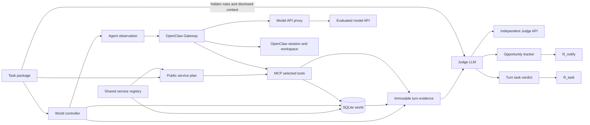

# Proactive Agent Benchmark Framework

Reusable infrastructure for long-horizon simulated tasks. The included fixture is synthetic and is only an end-to-end infrastructure check. Task domains and benchmark datasets are intentionally deferred.

## Architecture



The controller groups events by timestamp. Each timestamp is an environment tick, even if no agent runs. It applies all mutations in file order, captures `world_pre`, then invokes one Agent Turn if a user message, notification, or scheduled wakeup occurs. OpenClaw handles its own planning, model calls, session history, and tool loop. The controller gathers MCP calls from the service audit log and proactive notifications from a simulated inbox. `world_post`, response, and workspace/session reference complete the frozen turn evidence. Task and notification judging are separate calls. Subsequent ticks continue from each run's persistent SQLite state.

The Agent sees only scheduled messages, its OpenClaw session and workspace, and the task-selected MCP tools. It never receives future events, authoritative snapshots, `goal_context_t`, or judge files. The controller builds `goal_context_t` only from user-message disclosures through the current turn. The judge sees that context, hidden rules, authoritative snapshots, action evidence, prior evidence, and opportunity state. The OpenClaw container mounts only its state volume and a config generator; judge files, run evidence, and Judge credentials are absent. The world service receives a public service plan containing only service bindings and allowed tools. No real channel is configured. The private Docker network has no external route; only the narrow model proxy can reach the configured Agent model API.

## Package schema

`manifest.yaml`: `task_id`, `metadata`, timezone-aware `initial_timestamp`, `duration_seconds`, `services` bindings, initial `workspace_files`, `tool_permissions` mapping binding IDs to operations, `judge` settings (`completion_policy: expire|keep`), and relative paths `initial_world`, `events`, `context`, `notification_rules`, `judge_instructions`, and `evidence_sources`. A binding has `id`, registered `service`, optional service `config`, and optional `tool_prefix`. The legacy `adapters: [kv]` field remains supported. The two new Judge paths are optional for older tasks and must resolve inside that task's `judge/` directory.

`initial_world.yaml`: mapping of service binding ID to that task's initial JSON-compatible state. The same registered service can be bound by multiple tasks with different data and events. Each run has its own SQLite database. Services validate state and operation arguments before execution. The controller alone can inspect snapshots and history. `reset` and `replay` reproduce recorded operations from the initial state and check result/changes for divergence.

## Reusable services

[`services.py`](src/probench/services.py) defines `DomainAdapter`, `OperationSpec`, `ServiceBase`, and `ServiceRegistry`. Each service provides a Pydantic state schema, typed input models for operations, read/write classification, descriptions, and an `execute` implementation. Register a factory under a stable service name, then select it in task manifests. For a separate module, set `BENCH_SERVICE_MODULES=your_package.service_module` in all benchmark services; that module should register its factory in `DEFAULT_REGISTRY`. Future Calendar, Email, Notion, Booking, and Weather services belong in such modules; their schemas and behavior are not implemented yet. The included `kv` and `counter` services are domain-neutral infrastructure fixtures. `examples/reuse_a` and `examples/reuse_b` use the same `CounterAdapter` class with different initial values, mutations, and permissions.

`bench prepare <task_path> --output <plan_path>` writes a public plan from the task package. Docker Compose runs this as an isolated preparation service before starting the world service. [`world_mcp.py`](src/probench/world_mcp.py) registers only the permitted operations from that plan as typed MCP tools, plus the simulated `notify_user` tool. The world service has no task-package mount, and the OpenClaw container has neither the package nor the plan mounted. The controller checks the plan against the selected task before each run; the MCP service checks its digest and permissions for every Turn. A new Docker Compose project and run name are required when switching task packages.

`events.yaml`: time-sorted list with unique `id`, timezone-aware `at`, `kind` (`world_mutation`, `user_message`, `notification`, `scheduled_wakeup`, `time_advance`), optional `adapter`, `operation`, `arguments`, and `body`. Silent mutation is allowed. Multiple events may share a timestamp.

`context.yaml`: disclosures keyed to `user_message` event IDs. Each has `goals`, `preferences`, `constraints`, and optional `interaction`. The Judge context orders them by event timeline; future rows are never included in an earlier Turn.

`judge/notification_rules.yaml`: judge-only rules with `id`, `description`, `trigger_event_ids`, `deadline_seconds`, `related_goal`, `content_requirements`, `closing_conditions`, `unnecessary_conditions`, and `authorization_requirements`. Event IDs are candidate references, never sufficient proof that notification is required. An empty `trigger_event_ids` list permits a state-based rule to cite any current event. The LLM Judge checks actual impact, active user goals, ability to resolve the issue, authorization needs, urgency, and prior notifications. Rules are hidden from the Agent, but legitimate user preferences must be conveyed in user messages.

### Judge instructions and evidence sources

The shared [global Judge rubric](src/probench/global_judge_rubric.md) defines the four task scores, notification scores, priority, evidence reference syntax, and JSON output contract. Each task may add `judge/instructions.md` for domain interpretation: active goals and cancellations, relevant state relationships, meaningful progress, notification conditions, and safety or authorization dependencies. These instructions supplement the global rubric and cannot change scores. The Judge system message contains the global rubric; task instructions and evidence are supplied as data and are explicitly treated as untrusted. The Judge must use only `goal_context_t` disclosed through the current Turn.

`judge/evidence_sources.yaml` selects bounded evidence content, not arbitrary filesystem paths. For example:

```yaml
sources: [goal_context_t, world_pre, world_post, triggering_events, action_trace, tool_results, agent_response, previous_turns, world_history, previous_notifications, opportunities]
previous_turn_limit: 3
previous_notification_limit: 50
world_history_limit: 30
```

Current goal context, pre/post state, event references, actions, tool results, response, and opportunity state are required. Optional sources are `previous_turns`, `backend_state`, `world_history`, and `previous_notifications`. The evidence loader reads prior immutable Turn JSON from the selected run's `evidence/` directory, checks path confinement, task ID, Turn order, and timestamp, and sends selected content rather than filenames. World history is bounded and filtered through the current simulated time. Prior Turn records omit workspace data and other unnecessary fields. The Judge API response is schema-validated and each cited evidence reference must identify available supplied evidence. An event ID alone cannot justify a new notification opportunity; the proposal must also cite condition evidence. Missing files, future references, malformed responses, and invalid citations fail explicitly.

## Evidence and scoring

Each `evidence/turn_NNNN.json` contains event IDs, timestamp, disclosed context, observation, pre/post state, ordered action trace and tool results, response, memory versions/delta, and related opportunities. OpenClaw session memory uses logical before/after version references tied to its persistent session. Evidence files are written once; `evidence_hashes.json` verifies their bytes. `turns/` adds separate judge verdicts. `ticks.json`, `world_history.json`, `report.json`, and `report.txt` support inspection and replay checks. Generated runs are ignored by Git.

The Judge gives each **Turn** exactly one task score: harmful/violation `-1` takes priority, then goal progress `+1`, useful new actionable information `+0.5`, otherwise `0`. `R_task = max(0, sum(turn scores) / turn count)`. Individual actions are evidence, never scored separately. The production Judge uses an OpenAI-compatible chat completion endpoint and validates JSON against Pydantic schemas and available evidence references; malformed output fails the run. `MockJudge` is a deterministic test double and cannot validate the quality of LLM judgments.

Required notifications are scored once per opportunity: timely correct `+1`, partial `+0.5`, missed after deadline `0`, seriously wrong or unauthorized `-1`. Open obligations persist across Turns. Turns while an obligation is pending are excluded from ordinary silence scoring. Eligible quiet Turns score `+1` for silence or `-1` for unnecessary proactive notification. `R_required` and `R_not_required` are independent means, and `R_notify = max(0, 0.5*R_required + 0.5*R_not_required)`. If either category has no samples, its value and `R_notify` are `null` (N/A); weights are not changed. `R_task` and `R_notify` are the only primary metrics.

## Run

```bash
python -m pip install -e '.[test]'
bench validate examples/synthetic
bench validate examples/reuse_a
bench prepare examples/reuse_a --output plans/reuse-a.json
bench run examples/synthetic --agent mock --judge mock --output runs/example
bench report runs/example
pytest -q
```

For a real Judge set `BENCH_JUDGE_BASE_URL`, `BENCH_JUDGE_API_KEY`, and `BENCH_JUDGE_MODEL`, then choose `--judge openai`. The API must support `/chat/completions` and JSON object response format. OpenClaw is the default Agent; pass `--agent mock` for deterministic local tests or `--agent module:Class` for another runtime. The fixture remains runnable without credentials. Full domain adapters, real task packages, Judge calibration, and production operational deployment are future work.

## Docker and OpenClaw

The production Agent adapter calls the [documented Gateway chat completions API](https://docs.openclaw.ai/gateway/openai-http-api) with one stable `user` per run. OpenClaw uses an [MCP server](https://docs.openclaw.ai/tools/mcp) for world reads, writes, and `notify_user`, and its [tool policy](https://docs.openclaw.ai/gateway/config-tools/tool-policy) excludes filesystem, shell, web, session, gateway, browser, and real messaging tools. The simulated inbox stores notification text and simulated timestamps. The Gateway model provider uses the [custom provider configuration](https://docs.openclaw.ai/gateway/config-tools/custom-providers) with `bench/${AGENT_MODEL}` as the actual model. `AGENT_API_BASE_URL` and `AGENT_API_KEY` are held only by the model proxy. The Judge API variables are held only by the benchmark orchestrator. Neither side implicitly inherits the other's provider settings.

Copy `.env.example` to `.env` and edit it. Set `BENCH_TASK_NAME` to a directory under `BENCH_TASKS_HOST_DIR` (default `./examples`). Use a unique `COMPOSE_PROJECT_NAME` and `BENCH_RUN_NAME` for each run. Set `OPENCLAW_GATEWAY_TOKEN` to a random value for nonlocal deployments. The official image is the default; `OPENCLAW_IMAGE` can pin a compatible version. The Docker volumes retain OpenClaw memory, while `runs/<BENCH_RUN_NAME>` retains world state and evidence. Do not reuse a run name without resetting its stack and run directory.

```bash
docker compose build benchmark
docker compose up -d --no-build openclaw world model-proxy mock-model
docker compose run --rm benchmark bench validate examples/synthetic
docker compose run --rm benchmark bench run examples/synthetic --agent openclaw --judge openai --output runs/openclaw-demo
docker compose run --rm benchmark bench report runs/openclaw-demo
```

Offline integration test (real OpenClaw with local mock Agent and Judge API servers):

```bash
OPENCLAW_IMAGE=ghcr.io/openclaw/openclaw:latest bash scripts/test_docker_integration.sh
```

Use `OPENCLAW_IMAGE=terrarium/openclaw:latest` only if that compatible local image is already installed. The script verifies dynamic MCP registration, world tool calls, persistent session identity, notification delivery, two independent task configurations, and both metrics for the original fixture.

Real API smoke test after exporting all seven credentials/settings listed in `.env.example`:

```bash
bash scripts/test_real_api_smoke.sh
```

The script exits with status 77 if any required setting is missing; it never substitutes mock credentials. To reset containers, OpenClaw state, and the selected generated run:

```bash
BENCH_RUN_NAME=openclaw-demo bash scripts/reset_docker.sh
```

Known limitations: the domain-neutral fixture uses a scripted mock model for offline test reproducibility. The mock Judge tests plumbing, not judgment quality. The Gateway HTTP interface provides stable session continuation, while OpenClaw trajectory bundle export is not yet used as an additional evidence source. Docker networking restricts container routes, but host-level operators and Docker administrators retain access to mounted data. Real provider behavior and security policies should be smoke-tested with the chosen OpenClaw image before using untrusted tasks.

## Architectural reference

Studied [VibeLifeBench](https://github.com/evolvent-ai/VibeLifeBench) task entries, shared capability bindings, event handling, workspace bootstrap, tool traces, and stage state/rubrics. This framework shares service implementations across task packages while keeping each task's data and events independent. Its own additions are a task-independent LLM Judge contract, explicit cross-Turn notification opportunity settlement, dual independent metrics, isolated OpenClaw sessions, and an API proxy that confines Agent model egress. The synthetic fixtures are infrastructure evidence, not domain benchmarks.

